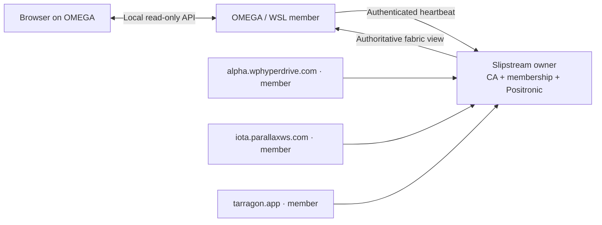
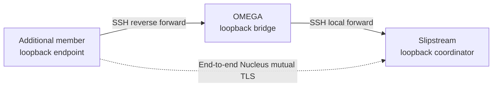

# Nucleus Alpha 0.2 architecture

Nucleus is a private membership and telemetry system. Each computer runs the same static Go executable. Its identity, inventory, Positronic, and dashboard components are packages within that process. Distribution comes from authenticated communication between those processes across machines.

## The roles

**Slipstream currently owns the fabric.** Its Nucleus process holds the fabric certificate authority, the authoritative membership list, and the Positronic coordinator. It also measures Slipstream's own resources.

**OMEGA's WSL installation is a member.** Its process measures the WSL VM, sends heartbeats to Slipstream, retrieves the shared fabric view, and serves the browser page locally. Alpha, Iota, and Tarragon have joined this same fabric. The live fleet has five online nodes, 64 logical CPUs, and about 148.5 GiB total reported RAM; [the rollout evidence](validation/fleet-rollout.json) records the observed result.

This is a logical star with one coordinator. Members initiate connections; they do not need a node API listener. There is no member-to-member routing or coordinator replication.

## What lives inside the executable

| Package | Responsibility |
| --- | --- |
| `fabric` | Durable identity, explicit membership, certificates, and TLS configuration |
| `inventory` | Local CPU/load, RAM, root filesystem space, interfaces, and uptime |
| `positronic` | Heartbeat ingestion, liveness, and the authoritative fabric view |
| `internal/dashboard` | Authenticated loopback browser API and bundled map |
| `cmd/nucleus` | Operator commands and process startup |

The reusable `fabric` package imports no dashboard, telemetry, or shell code. The Positronic role here is a Go package inside Nucleus. The existing Laravel/Selenium Positronic application and its database remain separate and untouched.

## How a computer becomes trusted

Every installation generates a persistent Ed25519 key. Its `node_id` is SHA-256 of the public key's SPKI encoding. The owner's separate CA key signs membership certificates; the CA certificate's SHA-256 is the shared `fabric_id`.

Pairing is an explicit exchange:

1. The owner exports a signed invitation with the pinned authority, endpoint, and expiring one-use secret.
2. The joining node accepts those pins and returns a signed certificate request proving possession of its own key.
3. The owner inspects that signed identity, compares the node ID through the trusted channel, and explicitly authorizes it.
4. The owner returns a signed grant and a constrained membership certificate.
5. The joining node verifies the grant against its pending request, own key, and pinned owner before accepting membership.

Identity keys and the CA key stay on their originating machines. Subsequent TLS 1.3 connections verify certificates on both ends. The coordinator also checks current membership on every request, so revocation applies to an existing session.

## How the map gets its data

Approximately every two seconds, a member collects a snapshot, sends `POST /v1/heartbeat`, then reads `GET /v1/fabric`. Positronic binds the submitted node ID to the authenticated certificate and records its own receipt time.

After ten seconds without a valid heartbeat, that member is offline and contributes zero available inventory. Its previous sample can remain visible as cached. Reconnection produces a fresh heartbeat using the same durable membership.

Keys, certificates, fabric identity, membership, and pairing receipts persist in private locked files. Heartbeat observations remain in memory. Restarting the coordinator preserves membership and waits for fresh remote observations.

The browser reads `GET /api/v1/fabric` from its own machine's loopback listener. A separate per-run bearer token authorizes that browser session. Node private keys and CA authority never enter JavaScript. “Local” is relative to the viewer: OMEGA's map marks OMEGA local; Slipstream's map marks Slipstream local.

## The physical connection in this prototype

The live inspection setup uses existing OpenSSH reachability. OMEGA's local forward carries traffic to Slipstream's loopback coordinator. Additional remote members can use a reverse forward back through OMEGA into that same owner path:

SSH supplies a private transport path without a public Nucleus port. Nucleus's certificates still authenticate its endpoints independently. Direct private-LAN operation can connect to the owner without SSH.

Rust `zh` remains the Bash-backed operator shell; its membership commands invoke Nucleus, and `zh fabric` starts this runtime. Its older `--map` stays local-only. Standalone `zzh` remains unchanged and does not create these tunnels; future clients can reuse the fabric protocol.

The Python inspection manager supervises temporary processes and tunnels. That operational helper is separate from product self-healing. Current inspection state uses isolated remote `/tmp` and local `.runtime` directories, with no installed system service. Iota uses a private directory under its user home because its `/tmp` filesystem is mounted `noexec`; that protection was left unchanged. A durable installation needs a persistent state directory; prototype `/tmp` state can be removed by reboot or cleanup.

The displayed totals are observed inventory. Alpha 0.2 supplies no scheduler, jobs, resource reservations, shared memory pool, mesh, or highly available control plane.
